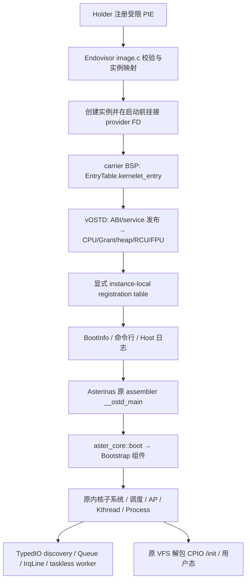

# 完整 Asterinas-on-Kernelet 启动集成

此前“没有完整启动入口”的代码阻塞已经由实际平台实现和完整链接产物消除；**尚未在真实内核运行中验证启动成功**。实现组合：Kernelet `647d68a00f3541715be4633e908d1ebb66a8762e`，Asterinas `48860174799d0796d4aa446c87274ad08a76dc53`，ABI 8。

## 真实调用链

Host 真正初始化发生在 `vostd/src/lib.rs::kernelet_entry` 的 `abi::init_tables`。Asterinas `ostd/kernelet` 选择转发整套 API 到这一份 vOSTD，未执行硬件 OSTD init。TypedIO 直接复用 Services.typedio 和真实虚拟 IRQ source route；**不需要、也没有随意补调用**硬件 OSTD 的 `install_host_service`。后者保留为普通硬件 OSTD 的受信任集成边界，不构成当前 Kernelet 启动依赖。

## 已补充的真实平台工作

| 原阻塞 | 当前实现 | 验证边界 |
|---|---|---|
| 多份 OSTD/allocator | hardware OSTD facade 在 kernelet feature 下转发到一份 vostd；原 frame/heap allocator 走平台 adapter | 完整依赖图与最终链接通过 |
| BootInfo | 只从授权 Grant 构造可用内存；CPIO 从完整 image 静态嵌入；无伪造 ACPI/framebuffer | 类型与范围测试、实际完整编译 |
| 完整 MM | frame metadata 真实保留/Drop、NonNullPtr identity、VmIO/POD/原子访问、可恢复 fault、current space TLB flush、原 COW/VMAR 调用层 | actual-algorithm native tests；真实页表/缺页仍待运行 |
| 用户线程 | 原 CpuSync 保存/恢复 FPU/FS/GS；真实 before_schedule 与 pre_user_run 接通；ABI 8 TLS | 实际 CpuSync/wrapper 回归；carrier 运行待验证 |
| IRQ/时间/调度 | 真实保存寄存器的 upcall、source generation/解绑、L1/L2 bottom-half、tick、AP、显式用户态调度边界 | 编译/模型/fixture；真实 IRQ 尚未执行 |
| 硬件依赖 | 仅此平台排除 ACPI/PCI/VirtIO/NVMe/framebuffer 等；Host console 输出、instance stop、电源注册和 TSC 时间 | 四配置编译；console 输入和真实 RTC 未提供 |
| 组件初始化 | guest-registry 保留原 inventory 类型，仅把注册函数放在私有重定位表，BSP 显式调用；原 Bootstrap/Kthread/Process 顺序不改 | 真正 registry primitive 测试、产物 31 个注册条目 |
| 完整镜像 | kernel/kernelet staticlib 仅连接原 Asterinas assembler 和真实 initramfs；Makefile 单独 profile 链接受限 PIE | 5645688 字节，实际 loader checker 和 10 项合同测试通过 |

## 完整产物与启动入口

路径：`/home/ym/typedio-work/kernelet/prototype/.build/asterinas.image`。SHA256：`79a91363ad54cfc79069c3f4a747735ded0d66b75453a49339e3934bce8ec1c2`。虚拟跨度 3364556 字节；16 MiB 限制保持不变。文件含符号表，因此文件长度与映射跨度不同。

EntryTable 位于 `0x2d91c8`（相对 image base），abi_version=8。三个 callback 来自真实 vOSTD 的 kernelet_entry、vcpu_entry、klet_virq_entry，均有指向 RX 段的 RELATIVE 重定位。共享 RX/R 与每实例私有 RW 段、无解释器/外部符号/TLS/自动构造均由最终产物检查。完整数据见 [image-static-audit.txt](evidence/image-static-audit.txt)。

31 条 registration table 项是注册函数，**不是 31 个组件**；注册只连接现有 inventory，不越过原组件 stage。注册期间 loader 不执行代码，BootInfo/命令行之前在 BSP 调用。原 `.init_array/.fini_array` 仍被 linker 拒绝，未通过删掉非空段逃避检查。

默认 CPIO 包含真正静态 ELF `/init`，输出一行后等待信号；它不进行通信或 Benchmark，也不是完整 Linux 发行版。可使用 `KLET_INITRAMFS=/absolute/path/rootfs.cpio[.gz]` 替换，重新验证 16 MiB 限制。

## 当前不能声称已完成的部分

完整启动、首个 syscall、实际 TLS/FPU 跨载体保存、SMP/IRQ、TypedIO 通信、真实 poll/epoll/信号和退出都需要可运行的 patched Linux 6.12/Kernelet Host。当前旧 Docker 无 KVM，所以这些未执行。移植代码可编译链接并不保证启动没有潜在运行问题；较大根文件系统和用户 workload 还受 prototype Grant 上限影响。
