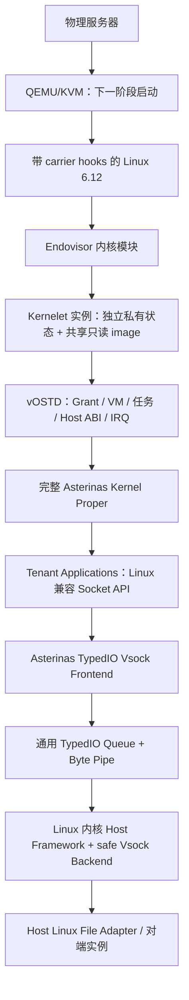
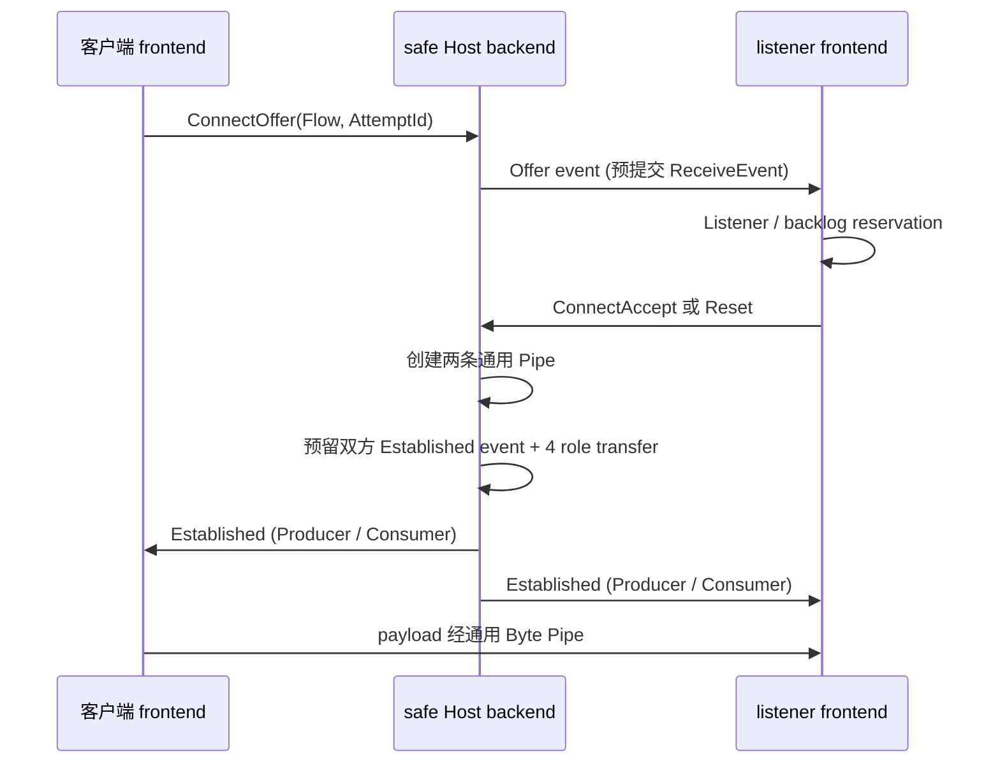

# TypedIO Vsock 与完整 Asterinas-on-Kernelet 项目交接

交接日期：2026-11-18。面向未参与此前开发的研究人员。

**当前结论：本次范围内的代码、完整镜像和当前环境可执行的门禁已经完成；真实系统启动及通信尚未验证。** 当前没有已知仍为空的关键 Vsock/平台实现，但编译与 native fixture 不能排除尚未暴露的运行问题。请先完成本文第八节的真实验收，再开展性能比较。

用户最终选择本次只保存本地 Commit 和 Git bundle。个人 Remote 已确认并配置，未 Push，未创建 PR，未合并 main，也未修改原设计或历史实验数据。远端认证失败详情见第九节。

## 一、项目目标与整体架构

目标是让**完整 Asterinas 安全内核**作为 Kernelet 的 kernel proper 运行，通过 TypedIO Vsock 与 Host 应用或其他实例通信。它不是只在一份 prototype 中运行 Echo，也不是在原硬件 Asterinas 内核里直接调用宿主函数指针。



Linux 调度 carrier（一个 carrier 承载一个虚拟 CPU）；Asterinas 调度该 vCPU 上的多个逻辑线程。两级调度不能混为一谈。完整 image 把 vOSTD 和 Asterinas 静态链接为一个受限 PIE；每个实例共享 RX/R 物理页，却拥有独立 RW/BSS 和重定位后的指针。

TypedIO 的请求控制路径是应用 Socket → Asterinas transport → vOSTD safe Queue → authenticated Host Service → Host Framework worker → Vsock Backend → 异步 completion/event。Established 之后，payload 使用两条通用 Byte Pipe 的 bounded opaque VmIO copy，后端不逐包转发 payload。Host helper 只配置内核 provider/listener FD；用户态不是 backend。

## 二、原始仓库、基线与原本实现

基线来自本地 Git clone reflog、分支 checkout 记录和当前原始 HEAD，而不是最新 upstream main。原始证据：[Kernelet Git 审计](evidence/kernelet-git-audit.txt)、[Asterinas Git 审计](evidence/asterinas-git-audit.txt)。

| 项目 | Kernelet | Asterinas |
|---|---|---|
| 最初仓库 | https://github.com/tatetian/kernelet | https://github.com/asterinas/asterinas |
| 最初分支 | design/typed-io；checkout reflog 从该分支进入实现分支 | main；之后显式 checkout 同一 e87d 基线再建立集成分支 |
| 原始基准 | `a5ec4b875d0a17890321a362fbc3fd16859b7eb4` | `e87d8425f987820431bd35068ef2d4489bdcc735` |
| 当前实现分支 | implement/typedio-vsock | integrate/typedio-vsock |
| 冻结代码提交 | `647d68a00f3541715be4633e908d1ebb66a8762e` | `48860174799d0796d4aa446c87274ad08a76dc53` |
| 用户个人仓库 | https://github.com/yanming404/kernelet | https://github.com/yanming404/asterinas |
| Remote | origin 保留上游，personal 指向个人 fork | origin 保留上游，personal 指向个人 fork |

原设计引用的 Asterinas `ab9a4cfdc726263b3f41ccea0337633e24b443fc` 是 OSTD API 参考，**不是此次最初 clone 的基线**。集成实际使用 e87d。Vsock、DMA、IRQ、VmIO/iovec 的两版本差异已核对，不能混用 API。

原始 Kernelet 已实现 Endovisor、carrier hooks 补丁、受限 PIE loader、Grant/Host heap、Linux VmSpace 服务、vOSTD 原型任务/调度、虚拟 tick/kick、FPU 服务，以及 hello、probe、yield、sched、mem、piecheck 等原型与原有构建/实验脚本。vOSTD 是 OSTD 形状的替代 provider，但原来只覆盖这些原型所需的子集。Host ABI 原始为 6；`KLET_ATTACH_DEVICE` 尚无完整 TypedIO 实现。

原始 Asterinas 是完整 Linux 兼容内核，具有系统调用、VFS、进程/线程、信号、调度和网络；OSTD 面向硬件启动，硬件页表、ACPI/PCI/VirtIO 等初始化不能直接用于 carrier。Vsock 原来经 VirtIO device → packet transport → Socket stream 层。它已经有逐线程 FPU/FS/GS 的 CpuSync 和 before_schedule/pre_user_run 机制；本次没有重新发明这些机制，而是使虚拟平台正确支撑它们。

参考研究员的 [Plucky923/asterinas kernelet 提交](https://github.com/Plucky923/asterinas/tree/7c7ba33375a0186fcd7004f72db53247722e3ad5)，实际阅读其 context/mod.rs、kernelet/entry.rs、kernelet/abi.rs。其 BootArgs、更多 EntryTable offset、CPU-local/MM/device 等合同与本仓库不同；只参考 inactive user GS 等机制，没有整体移植，也没有用该分支声称本实现已经启动。

## 三、相比原仓库，本次具体完成什么

以下按功能解释；逐文件新增/修改、行数与永久 GitHub 路径见 [SOURCE-CHANGES.md](SOURCE-CHANGES.md)。实现代码合计 **225 个文件：Kernelet 170，Asterinas 55**；另有本目录验证脚本、报告和证据。没有删除原仓库中的源文件；删除行主要是替换旧路径、收紧检查和平台条件编译。

### 3.1 Kernelet / Endovisor / 通用 TypedIO

| 模块 | 原来是什么 / 为什么改 | 现在如何实现与解决的问题 | 主要源码 / 验证 |
|---|---|---|---|
| Message / derive | 没有完整交换契约，Copy/repr(C) 不能证明安全 | 递归准入、字段编码、padding 不跨边界、资源 hooks；拒绝引用/Drop/union 等 | libs/typedio/message、typedio-macros；42 功能/9 拒绝 |
| Schema / Protocol | 无双方一致的类型描述和校验 | 确定性规范编码与 SHA256，统一协议叶子和 host-local 对应类型 | schema.rs/vsock.rs；两编译器导出 96 字节一致 |
| Device / Attachment | attach 无完整处理，尚无权限和代际链 | provider FD 在启动前导入实例；认证 CID/peer/port、schema/config、generation；发现/open/remove | main.c、typedio_host.c、UAPI、frontend.rs；native main |
| Queue | 无完整异步请求通路 | bounded slot、RequestId/tag、接受前 completion credit、乱序/恰好一次、cancel 与 quiescence 分离 | queue.rs、typedio_queue.rs、typedio_host.c；单测及 native |
| Host Framework | 用户态 runtime 不能代替内核 backend | Rust safe HostRequest/backend + 必要 C glue；持久 request token、真实 Linux worker、注销/退出 | typedio_host_api.rs/typedio_host.c；实际 .ko 与 ASan fixture |
| Byte Pipe | 原 Grant 归单实例，不能直接共享任意 backing | Host-owned 零化存储，独立 metadata lock、role capability、bounded reservation，opaque copying | pipe.rs、typedio_pipe.c、resources.c；wrap/partial/EOF/reset |
| 资源转移 | 单一 Guest Drop 无法保护异步 Host/跨实例访问 | prepare/commit/rollback、双目标预留、pending ref/lease/quarantine；账目保留至访问结束 | resource.rs、typedio_resources.c；配额/死亡/遗忘 reservation |
| Grant backing | 实例释放可能早于 Host lease | 独立 refcount/module 引用；映射拆除、carrier eviction 后才能完成相应 release | grant.c、sandbox.c；实际 grant.c native 回归 |
| Notification | 合并 pending bit 无法表达多个来源和 rearm | 每源 readiness/interest/binding generation，drain/rearm 同步，summary bit 只作提示 | notification.rs、IRQ poll/resources；并发模型/native |
| vOSTD IRQ | 缺少完整 TypedIO callback/source 路由 | IrqLine 固定目标 vCPU 和 generation、无锁回调、同步注销；真实寄存器 TrapFrame | irq/line.rs、vcpu.rs、arch/trap.rs；编译/模型，运行待验 |
| Vsock Backend | 没有 flow-addressed TypedIO 服务 | CID 路由、Flow+Attempt、pending receive/event、有界 backlog、两 Pipe/双事件预留、shutdown/reset/退休 | typedio_vsock.rs、flow.rs；native vsock/asterinas |
| Host Adapter | 不能遗漏 Host 应用接入 | 同一 flow/pipe 的 listener/accept/backlog、Linux FD、partial usercopy、poll、wait generation | typedio_socket.c/host_socket.rs；真实 fops fixture |
| ABI 8 TLS | prototype 没有逐线程 thread-pointer 支持 | carrier Linux 栈服务读写真实用户 FS/inactive GS，更新 thread bookkeeping | carrier.c、user_tls.rs；CpuSync/TLS/94 布局检查 |
| Loader / Build | 原有 PIE 只连接小原型 | 新增 full Asterinas staticlib profile、真实 CPIO、显式注册表；保留原 loader 限制 | Makefile、kernelet.lds、guest-registry；完整 PIE/10 合同测试 |

### 3.2 完整 Asterinas 与 vOSTD 平台适配

| 模块 | 原始状态 / 问题 | 当前适配与理由 | 源码与验证 |
|---|---|---|---|
| OSTD provider | 全依赖图使用硬件 OSTD | kernelet feature 将 API 转发到一份 vostd；硬件初始化排除 | ostd/Cargo.toml、ostd/src/lib.rs；依赖图/完整链接 |
| Allocator | 硬件 frame/heap allocator 会重复提供全局分配器 | frame 统计来自真实 Grant bitmap；heap 使用 HostHeap；CPU-local owned adapter | vm/mod.rs、osdk/deps；native metadata/ownership |
| BootInfo | 只有 prototype 命令行不足以启动完整内核 | 从授权 Grant 构造 memory regions；内嵌 CPIO；无虚构固件 | vOSTD boot；范围测试/链接 |
| Frame / Segment | prototype 忽略传入 metadata，不满足 page cache | metadata 存至末次 ref，Drop 先于 backing 复用；RCU identity 使用对齐私有 slot | frame.rs/meta.rs；真实 factory/Drop/ref 回归 |
| VM / VmIO | 缺少完整内核调用的 POD、原子、fault 接口 | 保留 Host vm_*；增加有界复制、current-root 授权 fault handler、futex 原子与 TLB shootdown | mm/io/fault/tlb/vm_space；native lazy-fault/atomic |
| CPU-local / RCU / 锁 | 只有 prototype 所需 API | 复用 OSTD 算法，补 dynamic owner、guard lifetime、单指令 RMW、context-switch quiescence | cpu/local、sync/rcu；并发与编译拒绝 |
| 调度 / 用户态 | 完整 Asterinas 的 ThreadLocal 不支持 kernel preemption | 此平台只在用户态/显式调度边界切逻辑任务，保留 PRE/POST hook、AP 与 idle | task/scheduler、UserContext.execute；源码/编译 |
| 异常 / IRQ | 原型只有部分异常与 IRQ scope | 补 #SS、真实 upcall TrapFrame、L1/L2 bottom half、tick/source/kick | arch/cpu/context、irq；编译，真实执行待验 |
| FPU / FS / GS | CpuSync 已存在，虚拟 provider 不完整 | pre_schedule 保存、pre_user_run 恢复；XRSTOR 允许状态的 INIT 分量正确清零 | carrier FPU/TLS、CpuSync 原代码；native TLS，不冒称 FPU runtime |
| 硬件依赖 | ACPI/PCI/VirtIO/NVMe/显示设备需要真实硬件 | 仅 Kernelet 构建排除，保留原硬件默认配置；loopback/VFS/进程不删 | core/Cargo 与各 cfg；四配置编译 |
| Console / 时钟 / Power | 硬件串口/CMOS/ACPI 不能直接操作 | Host console 输出、TSC 单调时间；上游 dummy RTC；电源操作只结束实例 | console/time/power_kernelet；实际编译 |
| 组件初始化 | inventory 自动构造段被 loader 拒绝 | 只替换注册 carrier；显式表在 BSP 调用，原 stage/priority init_all 不改 | component/cmdline/power、guest-registry；31 项表/native registry |
| Vsock frontend | 原 stream 绑定 VirtIO transport | transport abstraction 把现有 Init/Connecting/Listen/Connected 接到 TypedIO，默认 IRQ worker | socket_transport*.rs/typedio.rs、stream；实际源码 native/完整编译 |
| 完整 Image | 没有 full Asterinas Kernelet 产物 | 原 assembler __ostd_main → aster_core::boot；staticlib+PIE+可替换 CPIO | kernel/kernelet；真实最终链接 |

内存统计中的 HostHeap 数值是请求的 live bytes，**不是**硬件 OSTD 的 slab page 开销；Linux allocator overhead 不包含其中。DMA 平台 owner 使用 Grant 内真实存储，非 coherent streaming 模式有独立 CPU/device runs 与同步复制；没有宣称完成 DMA-bearing Message 的生产 transfer hooks，这不属于本次 Vsock 所需资源范围。

复用代码与新增代码须区分：已有 vOSTD task 层来自原项目；本次 sync/rcu/rwlock/mutex/log/util 等主要复用 Asterinas OSTD 的算法并适配模块/虚拟 CPU；metadata、TLS Host Service、TypedIO SDK/backend、ownership ledger、dynamic CPU-local 和 full-image assembler 是本次实现或扩展。源码保留原 SPDX。23 个直接对应文件的实际来源见 [UPSTREAM-REUSE.md](UPSTREAM-REUSE.md)。完整逐文件对比不把复用代码算成全部原创。

## 四、ABI 8 与 FS/GS：Book 语义如何落地

ABI 是 Host 与 image 的 C 布局、函数签名和版本合同；不是 Linux syscall ABI，也不是 TypedIO 协议的 schema digest。原基线 ABI 6 → 增加 TypedIO 的中间 7 → 本次 TLS 服务的最终 8。BootArgs/Services/EntryTable 版本必须一致；旧 image 被明确拒绝。

Book [Into user mode and back](https://github.com/tatetian/kernelet/blob/main/book/src/accepted-design/into-user-mode-and-back.md) 已要求完整 vOSTD 为每线程保存 FS 并在用户态进入前设置；其他依据是 [ABI](https://github.com/tatetian/kernelet/blob/main/book/src/accepted-design/the-kernelet-abi.md)、[Tasks/vCPU](https://github.com/tatetian/kernelet/blob/main/book/src/accepted-design/tasks-and-virtual-cpus.md)、[Processor sharing](https://github.com/tatetian/kernelet/blob/main/book/src/accepted-design/sharing-a-processor-politely.md)。本次只是落实这一已有契约并完善用户 GS，不是宣称原设计没考虑 FS。

```c
s64 (*user_tls)(u64 which, u64 operation, u64 *value);
// which 0=FS, 1=user GS; operation 0=read, 1=write
```

完整路径：每个 Posix ThreadLocal 的 CpuSync<FsBase/GsBase> → vOSTD FsBase/GsBase wrapper → carrier service stub → Linux 栈 klet_do_user_tls → 实际 FS / inactive user GS。切换逻辑任务之前，PRE_SCHEDULE_HANDLER 调用 before_schedule，保存 OnCpu 状态；每次 UserContext.execute 调用 user_run 前，pre_user_run 调用 before_user_exec，必要时恢复 InMemory 状态。没有切换且状态仍有效时，原 CpuSync 的 OnCpu/Both 优化免除重复写入。

Host 的 Kernel GS 指向 Linux per-CPU 数据，与 tenant 用户 GS 完全不同。此平台不在 vOSTD 执行 SWAPGS；Host 清用户 selector 后更新 inactive MSR_KERNEL_GS_BASE，并同步 current->thread.gsindex/gsbase；FS 同步 fsindex/fsbase。读取来自真实 CPU，而非上次写入缓存。Linux 调度/迁移 carrier 时能据此保存和恢复自己的 task 状态；tenant syscall、exception、IRQ 又按原 hooks 回到同一执行模型。

用户 WRFSBASE/WRGSBASE 的前提是 CPU 支持且 Linux 启用 CR4_FSGSBASE。Host 用 Linux 生效的 feature，vOSTD 没有无条件执行该指令。允许 FSGSBASE 时可保存/恢复规范的高半区值；非规范值拒绝；无 FSGSBASE 时按用户范围限制。高半区 base 不赋予用户访问 Host 内存的权限。当前只支持 native x86-64/四级页表；Xen PV 拒绝，57 位 policy 测试不等于 LA57 平台已实现。

新同步 scalar 仅允许当前实例 host-private live stack ledger 中的完整对齐 8 字节，锁内 nofault copy，Host 不保留指针，不能借共享 stack_limit 授权。实际 C/Rust ABI probe 比较六张表 94 项版本/大小/对齐/偏移。更多边界与参考说明见 [PLATFORM-ABI-EXTENSION.md](PLATFORM-ABI-EXTENSION.md)。**以上真实硬件保存/恢复、迁移与 NMI 路径尚未运行验证。**

FPU 仍使用原 Host staging page：私有快照校验后 XRSTOR。修正了只根据 XSTATE_BV 恢复会遗留上一线程 INIT 分量的实现问题，并正确初始化 x87/MXCSR；FXSAVE-only 路径不调用 XGETBV。未执行真实 FPU context switch，不能把 TLS fixture 视为 FPU 证明。

## 五、TypedIO Vsock：连接、数据与资源完整流程

依据固定 [TypedIO 原设计](../../book/src/design-proposals/2026-11-08-typed-io.md)，覆盖 Overview 至 Data-path/waiting 的本任务范围；不实现 Block/Filesystem/Pmem，也不新增握手消息。

1. **授权发现。** Host 注册内核 backend/provider，配置 Protocol/schema/CID/peer/port。Holder 在 carrier 启动前导入 provider FD。Guest discovery/config/open 得到能力句柄；Host 从实际 carrier 识别 caller，不信任消息中的身份声明；移除/复用均检查 generation。
2. **异步控制。** Frontend 有界 Queue 提交 ControlSend/ReceiveEvent。接受请求前预留 completion credit；满时返还原请求。RequestId/tag 不复用，允许乱序与“submit 返回前已完成”。cancel 只发出取消意图，不能证明访问结束。
3. **连接建立。** 下面序列保持原设计，内部 Preparing 状态只是串行化实现，不是新握手阶段。



双方 event/role 必须都预留成功才能发布任一 Established；同 CID 回环也占两个不同槽。ControlSent 只表示接受控制请求。晚到控制消息不能影响同地址的新 Attempt；schema/代际和 peer 权限持续有效。

4. **payload。** 两条 Pipe 分别承载两个方向。Producer/Consumer 对 contiguous prefix 建立 reservation，在 metadata lock 外以受限 VmReader/VmWriter 做 bounded opaque copies，再提交实际字节数。没有向 safe Rust 暴露并发可变 slice，也没有 Vsock 专用 payload ring。部分 copy fault 返回前缀，ring wrap/peek/zero commit 和重试受测试覆盖。
5. **等待。** readiness/interest 与事件 publication/rearm 使用共同同步规则；每源状态持久保存，summary IRQ bit 可以合并。Frontend IRQ → taskless worker drain/rearm → Pollee；已有 SocketPrivate block_on 保留信号感知语义。只有显式 typedio-polling feature 才轮询。Native Pollee/poll_wait 只是 primitive fixture，因此真实 epoll/完整信号仍待验收。
6. **关闭与失败。** Shutdown 保持方向与半关闭 EOF；Reset 用通用 PipeControl 中止。Listener/backlog、取消、移除、暴露 FD 失败与实例死亡都复用 Flow+Attempt/代际/清理路径，Host worker 不等待 Guest 进展。
7. **资源退休。** Prepared → Active → Retired/Detached → Released 与 quarantine 按原设计执行。请求持有 message/credit/lease；finish 后有 active access 仍不得发布最终 completion。Guest reservation 即使被遗忘仍计费，carrier eviction/映射拆除且访问停止后才可清理；Host-origin reservation 不因 Guest 死亡被强制撤销。Grant 的原始实例引用与 Host lease 分离，最终引用释放前不回收 backing。配额随 retained accounting owner 存续，不能早退款。

Host Application Adapter 是自定义 Linux File 接口，支持 listener/accept/read/write/poll 和 FD 安装；**不承诺现有未经修改的 Host AF_VSOCK 二进制直接兼容**。真正的 Guest↔Host 和 Guest↔Guest 整链路只在 primitive fixture 环境运行过，不是跨真实 QEMU 实例的实验证据。

## 六、源码索引、代码复用与产物

[完整源码清单](SOURCE-CHANGES.md) 给出每个变更的 A/M 类型、加删行数及冻结代码 SHA 的 GitHub URL。Kernelet 170 文件为 130 新增、40 修改；Asterinas 55 文件为 12 新增、43 修改；以该清单的实际 Git 统计为准。本目录所有交接/验证文件另外列出。没有源文件整文件删除。

重要实现入口：

- [Host service/carrier](https://github.com/yanming404/kernelet/blob/647d68a00f3541715be4633e908d1ebb66a8762e/prototype/linux/endovisor/carrier.c)、[Host Framework](https://github.com/yanming404/kernelet/blob/647d68a00f3541715be4633e908d1ebb66a8762e/prototype/linux/endovisor/typedio_host.c)、[资源 ledger](https://github.com/yanming404/kernelet/blob/647d68a00f3541715be4633e908d1ebb66a8762e/prototype/linux/endovisor/typedio_resources.c)、[safe Vsock backend](https://github.com/yanming404/kernelet/blob/647d68a00f3541715be4633e908d1ebb66a8762e/prototype/linux/endovisor/typedio_vsock.rs)。
- [vOSTD entry](https://github.com/yanming404/kernelet/blob/647d68a00f3541715be4633e908d1ebb66a8762e/prototype/vostd/src/lib.rs)、[typedio frontend](https://github.com/yanming404/kernelet/blob/647d68a00f3541715be4633e908d1ebb66a8762e/prototype/libs/typedio/src/frontend.rs)、[虚拟 IRQ](https://github.com/yanming404/kernelet/blob/647d68a00f3541715be4633e908d1ebb66a8762e/prototype/vostd/src/irq/line.rs)。
- [OSTD facade](https://github.com/yanming404/asterinas/blob/48860174799d0796d4aa446c87274ad08a76dc53/ostd/src/lib.rs)、[完整 assembler](https://github.com/yanming404/asterinas/blob/48860174799d0796d4aa446c87274ad08a76dc53/kernel/kernelet/src/lib.rs)、[Socket transport](https://github.com/yanming404/asterinas/blob/48860174799d0796d4aa446c87274ad08a76dc53/kernel/core/src/net/socket/vsock/typedio.rs)、[原 CpuSync](https://github.com/yanming404/asterinas/blob/48860174799d0796d4aa446c87274ad08a76dc53/kernel/core/src/process/posix_thread/cpu_sync.rs)。

这些是**个人仓库的目标永久路径**；本次未 Push，上传之前对应新 SHA 链接在 GitHub 上不可用。本地文件与 bundle 才是当前交付实体。

完整 PIE：`prototype/.build/asterinas.image`，5645688 字节（约 5.38 MiB），virtual span 3364556 字节。SHA256 `79a91363ad54cfc79069c3f4a747735ded0d66b75453a49339e3934bce8ec1c2`。三个 LOAD 分别 RX/R/RW，15181 个 symbol-free RELATIVE 重定位，EntryTable offset `0x2d91c8` 的三个 callback 都落在 RX。image virtual span 上限 16 MiB 未扩大。文件大小含符号表，不等同映射跨度。

默认 `asterinas-initramfs.cpio` 中是真正静态 `/init`，打印后等待信号。可以换真实实验用户态，不是完整发行版；镜像/`.ko`/CPIO/target 是生成产物，不进入源码 Git。最终 bundle 之外可附带 image 与 CPIO；`.ko` 只适用于匹配构建树，不能直接加载在当前 6.8 宿主。

### 工具与构建

Guest/native：nightly-2026-07-21，实际 rustc 1.99.0-nightly；Linux 6.12 Rust：1.78.0；bindgen：0.65.1；本地 clang：18.1.3。vDSO 仓库 https://github.com/asterinas/linux_vdso ，固定 `8af571775a3d3a1df3e84fc9709b9d6b160c771a`。

两仓库必须相邻并命名 `kernelet`、`asterinas`；Cargo path dependency 是当前明确的组合构建约定。当前 `/home/ym/typedio-work/env.sh` 只设置任务私有 toolchain/Cargo 路径与 VDSO_LIBRARY_DIR，没有改 shell startup。迁移后需重建这些路径，不能把该文件不存在误判为源码不可编译。

只构建完整 image：

```bash
# 当前服务器先 source /home/ym/typedio-work/env.sh
# 新服务器先安装固定 toolchain / rust-src、cargo-osdk，并配置真实 vDSO
export VDSO_LIBRARY_DIR=/path/to/linux_vdso
make -C /path/to/kernelet/prototype KLET_KERNEL=asterinas image
# 可选：KLET_INITRAMFS=/absolute/path/real-rootfs.cpio.gz
```

Make 内部从 Asterinas workspace 构建 `asterinas-kernelet`，kernelet profile 为 panic=abort/size optimization，编译所有代码为 PIC 后由 ld 形成受限 PIE。不能用普通 cargo osdk 的硬件启动 ELF/bzImage 代替该文件。第一次下载依赖需允许 Cargo fetch；最终命令 offline/locked 要求依赖已缓存。

Host Linux 必须应用原项目的 `prototype/linux/patches/0001-carrier-hooks.patch`，使用 CONFIG_RUST=y 的 **Linux 6.12 构建树**。实际配置保存在 [linux-config-used.config](evidence/linux-config-used.config)。原 fragment 并不自动保证 Rust 已启用；最终门禁明确检查 CONFIG_RUST=y。不要在旧宿主加载模块或安装/替换内核。

## 七、编译与测试验收结果

最后一次统一门禁退出码 0。完整命令、名称、primitive 替代边界与日志见 [TEST-REPORT.md](TEST-REPORT.md)。

| 层次 | 通过结果 | 失败 |
|---|---|---|
| SDK 功能 | 42 | 0 |
| Message derive 拒绝 | 9 类 | 0 |
| 原生生产源码整链路 | 5 个 executable，C ASan/UBSan/leak | 0 |
| 平台算法 | 12 + 1 个 guard 生命周期编译拒绝 | 0 |
| TLS policy | 29 assert | 0 |
| 实际 image ABI | 94 比较 | 0 |
| 真实完整 image 合同 | 10 正反测试 | 0 |
| 编译/链接 | Rust no_std/workspace、Linux C/Rust/MODPOST、Asterinas 四配置、full PIE、原型 PIE | 0 |

发生过但已解决的测试变化：两个 UI 快照仅因格式化改变行号/源码片段；先核对预期拒绝原因再更新。ABI C probe 的 `protected_` 字段名按真实 C 定义修正。最终所有项目已重新运行，不把早期失败日志当最终结果。

证据不包含完整 kernel ktest、真实 EPOLL、signal subsystem、NMI/IRQ/top-half、Linux carrier runtime 或性能测试。有 missing_docs/unused 等 warning；未声称 clippy/lint 零告警。

## 八、完成度、限制与下一阶段顺序

**代码已完成并编译/链接：** 当前任务范围的 Message/Schema/Protocol、发现/挂接、Queue/Pipe、Host Framework/backend/File、资源生命周期、vOSTD 平台与完整 Asterinas assembler/PIE。设计矩阵每一项都给出实际位置和证据分级。

**部分功能是明确的平台范围：** Host console 只有输出，输入没有 Host ABI；RTC 采用上游 dummy epoch，单调时间用真实 TSC；无物理 PCI/VirtIO/NVMe/ACPI/framebuffer；panic=abort 结束实例而非 hardware unwind/catch。当前 vOSTD MAX_CPUS=8，尽管 Host UAPI 容许更多，请只配置 1–8 vCPU；四级页表限定仍在。Host Grant 上限由 PAGE_SIZE<<MAX_PAGE_ORDER 决定，本次构建为 4 MiB；vOSTD bitmap 的 16 MiB 容量不是实际 Host Grant 扩容。较大用户态/发行版需另行审查内存需求，不能据 full PIE 小于 16 MiB 推断它们均可运行。

**尚未验证而非伪装成通过：** 以下全部待新服务器执行，本次没有启动 QEMU、加载模块、修改宿主配置或运行 Benchmark。

1. 恢复同一提交对和工具链，重新执行完整离线门禁并记录产物 hash/配置。
2. 使用 patched Linux 6.12 在 QEMU/KVM 内启动，匹配构建 `.ko`；先注册完整 Asterinas image，无设备情况下确认正常 `/init` 与 syscall，然后启动前挂接授权 TypedIO provider。不得直接将旧 `.ko` 加载到另一内核。
3. 单 vCPU 验证真实 FS/GS/FPU：至少两个 tenant 线程不同 base；arch_prctl、FSGSBASE 高半区规范与非法值、clone、信号/rt_sigreturn、阻塞/调度、carrier 被 Host 抢占与迁移。再扩至 2–8 vCPU，检查 NMI/IRQ 与 GS 隔离。
4. 运行真实 Guest↔Host、Guest↔Guest、多 attachment、多 flow、同 CID 回环；保留 `/init` 成功、设备发现和真实 Established 的证据。
5. 完整 poll/epoll、signal-aware wait、nonblocking、partial fault、peek、half-close/EOF/reset；监听关闭、取消、代际复用、移除与并发退出。
6. 压力验证 Request/Reservation quiescence、quarantine/配额、carrier eviction、tenant mapping teardown、Grant lease 延迟释放、callback 注销及 IRQ publication/rearm。确认泄漏与 module refs 清零。
7. 上述真实正确性通过后，再用相同 Linux/CPU/vCPU/内存/负载条件比较 Klet-Vsock、VirtIO-Vsock、TypedIO Vsock；重新确认 504 组实验配置。本次没有吞吐/延迟结论。

Host 配置 helper 的实际 CLI 见 `tools/typedio-device/src/main.rs::run` 和 holder `--help`；它们仅作 provisioning。使用原有 runtime/cgroup 约定，在实验 VM 内授予所需权限，不修改旧服务器或其他容器。

## 九、Git 保存、兼容提交对与 bundle 恢复

实现提交：Kernelet `647d68a00f3541715be4633e908d1ebb66a8762e`；Asterinas `48860174799d0796d4aa446c87274ad08a76dc53`；最终 image ABI **8**。完整机器可读组合见 [VERSION-PAIR.json](VERSION-PAIR.json)。本交接文档/门禁脚本在 Kernelet 的后继提交，交付分支已包含它们；`git log -1 --format=%H` 可取得该文档提交，不改变兼容实现提交对。

个人 Remote 已验证 owner=yanming404、均为对应上游 fork。GitHub 连接的 Git-data 写操作返回 403 `Resource not accessible by integration`；服务器 HTTPS 无 username credential，SSH agent 不可用。**用户随后明确选择本次先保留本地 Commit 和 bundle，远端分支尚未上传。** 没有尝试绕过权限或向上游 Push。

交付目录约定 `/home/ym/typedio-work/handoff-20261118/`，含两个 `*.bundle`、校验清单和当前 image/CPIO；实际最终路径与 SHA 以目录内 manifest 为准。bundle 为**增量**，基线是本节两仓库原始 Commit，`git bundle verify` 会列出 prerequisite。它不是包含整个上游历史的 standalone clone。若完全离线没有基线，可用另附 `*-source.tar.gz` 恢复完整源码快照；该快照不带 Git 历史，也不包含 Cargo cache/工具链。

已有含基线的两个相邻仓库时：

```bash
# 在各自仓库中，先 verify；下面只更新本地实现分支，不碰 main
cd /path/to/kernelet
git bundle verify /path/to/kernelet.bundle
git fetch /path/to/kernelet.bundle refs/heads/implement/typedio-vsock:refs/heads/implement/typedio-vsock
git switch implement/typedio-vsock
cd ../asterinas
git bundle verify /path/to/asterinas.bundle
git fetch /path/to/asterinas.bundle refs/heads/integrate/typedio-vsock:refs/heads/integrate/typedio-vsock
git switch integrate/typedio-vsock
```

没有本地基线时先从相应上游 clone/fetch 原始 Commit，再导入 bundle；切换前保留接收方已有工作。将来在已配置 Git 授权的环境上传时，仅 Push `implement/typedio-vsock` 和 `integrate/typedio-vsock` 到 personal Remote；先核对 URL 与远端分支，遇分叉不得 force。无需 PR，不合并 main。

## 十、接手建议与问题处理原则

先读本文件、TEST-REPORT、COMPLIANCE，再按 [真实入口](BOOTSTRAP-INTEGRATION.md) 定位代码。遇到启动失败先区分平台 ABI/页表/初始化/allocator 与 TypedIO 协议，不通过 Mock、额外随意初始化调用或改握手掩盖平台错误。对已存在的 Reset、generation、Drop/rollback、retirement/quarantine 机制先理解后修改。

当前没有确认必须改变 TypedIO 协议或生命周期才能实现的设计矛盾。Book 已有 FS 契约；ABI 8 是用户批准的 prototype 平台补齐。复用参考分支需对其不同 ABI 作独立审查，不能整分支覆盖本工作。后续如发现真实设计矛盾，保留触发、固定版本源码位置、已有机制分析和最小方案后再决定。
